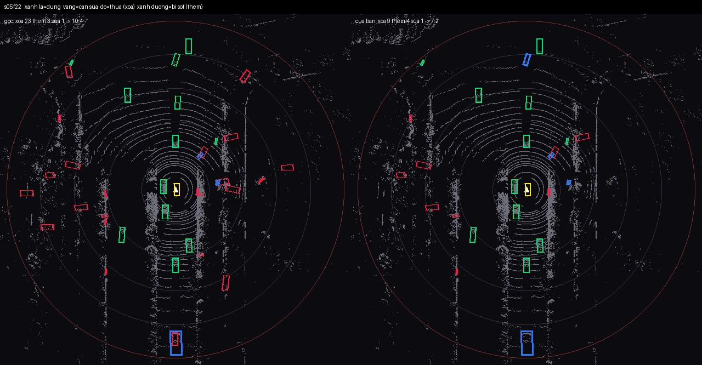

# Báo cáo Day 14 — Dương Mạnh Huy — 2A202603301

- Mã học viên dùng với `--student`: `2A202603301`
- `seed_tag` trong `frames_A.txt`: `82ac3100fd`

## 1. Dự đoán trước sweep (bước 5b)

Ghi **trước** khi chạy `scripts/pp_sweep.py`, rồi commit và push ngay (lịch sử commit là bằng chứng thời điểm viết). Không sửa phần này sau khi có kết quả.

- Tham số tôi nghĩ giảm công sửa nhiều nhất: **tăng `score_thr`** từ 0.1 lên khoảng **0.4**. `min_points` (5 hoặc 10) chỉ giảm được rất ít.
- Vì sao (nhìn ảnh BEV tập A: box thừa nhiều hay box sót nhiều?):
  - **Box thừa nhiều hơn hẳn box sót.** Cấu hình gốc trên tập A: xóa 40, thêm 4, sửa 3 → chi phí 17.5. Phần xóa chiếm 40 × 0.3 = 12.0 điểm, tức khoảng 70% chi phí. Trên ảnh `png_A/`, box thừa chủ yếu là hộp trùm lên bụi cây và cọc rào ven đường (Car và Cyclist), hộp trùng nhau, và hộp lơ lửng.
  - **Box thừa có score thấp.** Khi đối chiếu pre-label với nhãn tôi đã sửa, nhóm box bị xóa có score trung vị khoảng 0.38, còn nhóm box giữ lại là 0.78. Khoảng 24 box bị xóa có score < 0.4, trong khi chỉ khoảng 4 box giữ lại có score < 0.4. Tăng `score_thr` lên 0.4 có thể bớt khoảng 24 × 0.3 ≈ 7 điểm xóa, nhưng làm mất khoảng 4 box thật (mỗi box +1.0). Ước lượng chi phí giảm khoảng 3 điểm.
  - **Không nên tăng quá cao.** Ở mức 0.5, khoảng 13 box thật bị lọc mất (+13), lớn hơn phần xóa được (khoảng 31 × 0.3 ≈ 9.3). Vì thêm một box tốn 1.0, gấp hơn 3 lần xóa một box (0.3), ngưỡng quá cao sẽ làm chi phí tăng lại. Cyclist dễ bị mất nhất vì model KITTI cho Cyclist score thấp.
  - **`min_points` ít tác dụng.** Chỉ khoảng 2 box bị xóa có dưới 10 điểm LiDAR. Phần lớn box thừa nằm trên bụi cây nên vẫn có vài chục điểm. Ngược lại, một số xe thật ở xa (khoảng 38–45 m) cũng chỉ có 14–60 điểm.
  - Đây là ước lượng: script ghép box theo BEV IoU ≥ 0.3 và có ngưỡng riêng cho "sửa", nên số thật sau sweep có thể khác.

## 2. Tập A: sửa tay và tune

| Cấu hình | Xóa | Thêm | Sửa | Chi phí |
|---|---:|---:|---:|---:|
| Gốc | 40 | 4 | 3 | 17.5 |
| `best_config.json` | 16 | 8 | 3 | 14.3 |

- Tham số đã đổi trong `best_config.json`: chỉ đổi `score_thr` từ 0.1 lên **0.4**. `min_points` giữ 0, vì ở mức `score_thr` 0.4 cả ba mức 0, 5, 10 cho cùng chi phí 14.3. Sweep thử 15 cấu hình: `score_thr` ∈ {0.1, 0.2, 0.3, 0.4, 0.5} × `min_points` ∈ {0, 5, 10}.
- Chi phí từng frame của một số cấu hình (trích từ `sweep.csv`):

  | `score_thr` / `min_points` | s02f12 | s04f58 | s05f22 | Tổng |
  |---|---:|---:|---:|---:|
  | 0.1 / 0 (gốc) | 3.1 | 4.0 | 10.4 | 17.5 |
  | 0.2 / 10 | 3.1 | **2.8** | 10.1 | 16.0 |
  | 0.3 / 0 | **2.5** | 3.5 | 9.8 | 15.8 |
  | **0.4 / 0 (chọn)** | 4.2 | 2.9 | **7.2** | **14.3** |
  | 0.5 / 0 | 6.8 | 3.3 | 8.8 | 18.9 |

- Kết quả leave-one-out (dán các dòng `scripts/pp_sweep.py` in ra):

  ```
  s02f12: cấu hình chọn {'score_thr': '0.4', 'min_points': '0'} → 4.2 (tốt nhất có thể 2.5)
  s04f58: cấu hình chọn {'score_thr': '0.4', 'min_points': '0'} → 2.9 (tốt nhất có thể 2.8)
  s05f22: cấu hình chọn {'score_thr': '0.2', 'min_points': '10'} → 10.1 (tốt nhất có thể 7.2)
  ```

- Cấu hình có ổn định trên từng frame không? Vì sao tôi vẫn chọn (hoặc không chọn) nó:
  - **Không ổn định.** Mỗi frame có ngưỡng tốt nhất khác nhau: s02f12 tốt nhất ở 0.3, s04f58 ở 0.2, s05f22 ở 0.4. Cấu hình 0.4 thắng trên tổng chủ yếu nhờ **s05f22**, frame có nhiều box thừa nhất (23 box phải xóa ở cấu hình gốc).
  - **Leave-one-out cho thấy mức cải thiện thật nhỏ hơn nhiều.** Cộng chi phí của 3 lượt chấm trên frame bỏ ra: 4.2 + 2.9 + 10.1 = **17.2**, chỉ thấp hơn cấu hình gốc 0.3 (khoảng 2%). Trong khi đó, chọn và chấm trên cùng 3 frame cho kết quả 14.3 (giảm khoảng 18%). Ở s02f12, cấu hình chọn được (4.2) còn **tệ hơn cấu hình gốc** (3.1), vì ở ngưỡng 0.4 các box thật có score 0.3–0.4 bị lọc mất.
  - **Tôi vẫn chọn `score_thr = 0.4`** vì trong 15 cấu hình đã thử, nó có chi phí tổng thấp nhất (14.3). Nó cũng có tổng phần chênh so với mức tốt nhất của từng frame nhỏ nhất: 1.7 + 0.1 + 0 = 1.8, so với 3.0 của mức 0.3 / 10 và 3.5 của mức 0.2 / 10. Lựa chọn này chỉ dựa trên 3 frame, nên tôi xem tập B là phép kiểm tra thật.

## 3. Trước/sau (bước 8)



*Frame s05f22: bên trái là cấu hình gốc (xóa 23, thêm 3, sửa 1 → 10.4), bên phải là `score_thr = 0.4` (xóa 9, thêm 4, sửa 1 → 7.2). Xanh lá là box đúng, vàng cần sửa, đỏ thừa (phải xóa), xanh dương bị sót (phải thêm).*

- `scripts/pp_compare.py` báo **giảm 18%** công sửa trên tập A (17.5 → 14.3). Chỉ đổi một tham số: `score_thr: 0.1 -> 0.4`.

  | Frame | Chi phí gốc | `score_thr` 0.4 |
  |---|---:|---:|
  | s02f12 | 3.1 | 4.2 |
  | s04f58 | 4.0 | 2.9 |
  | s05f22 | 10.4 | 7.2 |
  | **Tổng** | **17.5** | **14.3** |

- Dự đoán ở mục 1 đúng hay sai? Giải thích bằng số box xóa/thêm/sửa:
  - **Dự đoán đúng.** `score_thr` là tham số có tác dụng, và mức tốt nhất đúng là 0.4. Tăng lên 0.5 thì chi phí tăng vọt lên 18.9 (thêm 16), đúng như lo ngại ở mục 1. `min_points` ít tác dụng: ở ngưỡng 0.1 nó chỉ giảm từ 17.5 xuống 16.9, ở ngưỡng 0.4 thì không đổi gì.
  - **Giải thích bằng số:** xóa giảm từ 40 xuống 16 (bớt 24 × 0.3 = −7.2), thêm tăng từ 4 lên 8 (mất 4 box thật × 1.0 = +4.0), sửa giữ nguyên 3. Tổng cộng −3.2, khớp với ước lượng ở mục 1 (bớt khoảng 24 box xóa, mất khoảng 4 box thật, giảm khoảng 3 điểm).
  - **Ảnh s05f22** cho thấy rõ cơ chế này: phần lớn hộp đỏ (hộp trùm bụi cây và cọc rào hai bên đường) biến mất ở ảnh bên phải. Đổi lại, một xe thật ở xa phía trước (khoảng 38 m, score 0.35) chuyển thành xanh dương, tức bị sót.
  - **Nhưng không đúng ở mọi frame.** s02f12 tăng từ 3.1 lên **4.2**. Frame này ít hộp thừa (chỉ 7 hộp), nên ngưỡng 0.4 bớt được 3 hộp xóa (−0.9) nhưng mất 2 box thật (+2.0): box ở ngay tâm LiDAR (score 0.33, xe thu dữ liệu mà tôi giữ trong `ref_A.json`) và một Cyclist phía sau (score 0.39). Vì vậy mức giảm 18% phụ thuộc nhiều vào s05f22. Leave-one-out ở mục 2 cho thấy trên frame chưa dùng để chọn, mức giảm chỉ khoảng 2%.

## 4. Tập B

Số đo từ `scripts/pp_prelabel.py --frames d14_2A202603301/frames_B.txt --config d14_2A202603301/best_config.json --gt d14_2A202603301/ref_B.json`:

| Xóa | Thêm | Sửa | Chi phí |
|---:|---:|---:|---:|
| | | | |

- Loại box tốn công sửa nhất ở tập B: ...

## 5. Giới hạn

- Nêu ít nhất 2 giới hạn (ví dụ: chỉ 3 frame tune; model KITTI không có Truck/Bus; chi phí là công thức, chưa phải thời gian sửa thật): ...
